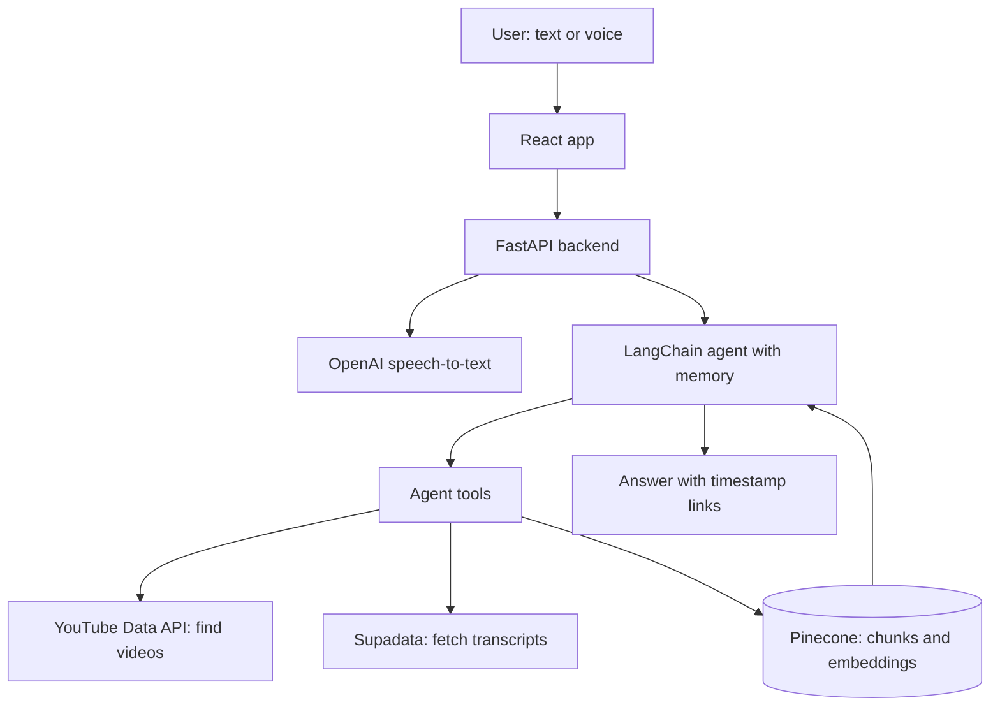

# VideoQA: Ask YouTube Videos Anything

**Live demo: [www.youtubchat.online](https://www.youtubchat.online)**

VideoQA is a multimodal AI chatbot that answers questions from YouTube videos. Ask by text or voice, and the agent finds relevant videos, reads their transcripts, and answers with links that jump to the exact moment in the video.

It was built as Project III of the Ironhack AI program. The original assignment is in [docs/project-brief.md](docs/project-brief.md).

## Features

- **Ask about any topic:** the agent searches YouTube, picks the most relevant videos, and reads them on demand.
- **Paste a video link:** add one specific video to the chat, then ask about it or get a summary.
- **Answers grounded in transcripts:** every answer comes from the videos and cites clickable timestamps. If the videos don't cover a question, the bot says so instead of guessing.
- **Voice input:** speak through the microphone or upload an audio/video file with your question.
- **Conversation memory:** follow-up questions keep the context of the chat.
- **Web and phone:** use it in the browser or install it as an app.

### Install on your phone

- **iPhone (Safari):** open the site, tap Share, then **Add to Home Screen**.
- **Android (Chrome):** open the site, tap ⋮, then **Install app**.

## How it works



1. The agent decides which tool to call for each message.
2. For a new topic, it searches YouTube and ranks the results by relevance to the question.
3. Transcripts are cleaned, split into chunks of about 250 words, embedded, and stored in Pinecone.
4. Each chat gets its own Pinecone namespace. Videos are also kept in a shared cache, so later chats can reuse them without fetching or embedding them again.
5. The agent retrieves the most relevant passages and writes an answer with timestamp citations.

### Agent tools

| Tool | Purpose |
|---|---|
| `search_video_transcripts` | Semantic search over the videos in this chat |
| `find_videos_on_topic` | Find, read, and embed new videos about a topic |
| `add_video_by_url` | Add one video from a pasted link |
| `list_videos_in_this_chat` | List the videos found so far |
| `get_video_transcript` | Get a full transcript, for summaries |

## Tech stack

| Layer | Technology |
|---|---|
| Frontend | React, Vite, installable as a PWA |
| Backend | FastAPI (Python 3.12) |
| Agent | LangChain `create_agent`, LangGraph checkpointer |
| LLM | OpenAI `gpt-5.4-mini` |
| Embeddings | OpenAI `text-embedding-3-small` |
| Speech-to-text | OpenAI `gpt-4o-mini-transcribe` |
| Vector database | Pinecone |
| Video search | YouTube Data API v3 |
| Transcripts | Supadata, with `youtube-transcript-api` as a fallback |
| Tracing and evaluation | LangSmith |
| Hosting | Vercel |

## Run locally

You need Python 3.12, Node.js, and API keys for OpenAI, Pinecone, and the YouTube Data API. A Supadata key is recommended. LangSmith is optional.

```bash
# Backend
python3.12 -m venv .venv
source .venv/bin/activate
pip install -r requirements-dev.txt
cp .env.example .env        # then fill in your keys
uvicorn app.app:app --reload --port 8000
```

```bash
# Frontend, in a second terminal
cd frontend
npm install
npm run dev
```

Open the URL that Vite prints. It forwards `/api` requests to the backend.

## Testing and evaluation

```bash
pytest                                     # unit tests
python -m evaluation.langsmith_eval        # LangSmith experiment
python -m evaluation.langsmith_eval --local   # run without LangSmith, save results to a CSV
```

The evaluation runs the agent on the questions in [evaluation/eval_questions.csv](evaluation/eval_questions.csv) and scores the answers, including LLM-judged correctness and groundedness.

## Deployment

The app runs on Vercel: [vercel.json](vercel.json) builds the React frontend and serves the FastAPI backend as a Python function under `/api`.

To deploy your own copy, import the repository in Vercel, keep the root directory as `./`, and add these environment variables:

`OPENAI_API_KEY`, `PINECONE_API_KEY`, `PINECONE_INDEX_NAME`, `YOUTUBE_API_KEY`, `SUPADATA_API_KEY`

Add `LANGSMITH_API_KEY`, `LANGSMITH_TRACING=true`, and `LANGSMITH_PROJECT` to enable tracing.

## Project structure

```text
api/          Vercel entry point
app/          FastAPI app, agent, tools, retrieval, memory, speech-to-text
ingestion/    YouTube search, transcripts, chunking, embeddings, Pinecone
frontend/     React chat interface and PWA files
evaluation/   Evaluation questions, metrics, LangSmith runs
tests/        Unit tests
docs/         Architecture and project brief
```

## Known limitations

- Only videos with English captions can be read. Videos without captions are skipped.
- The free Supadata plan allows 100 transcripts per month. Videos already in the shared cache don't use any.
- The YouTube Data API's free quota allows roughly 100 searches per day.
- Conversation memory is held in server memory, so on Vercel a chat can lose its context between messages. A Postgres checkpointer would fix this.
